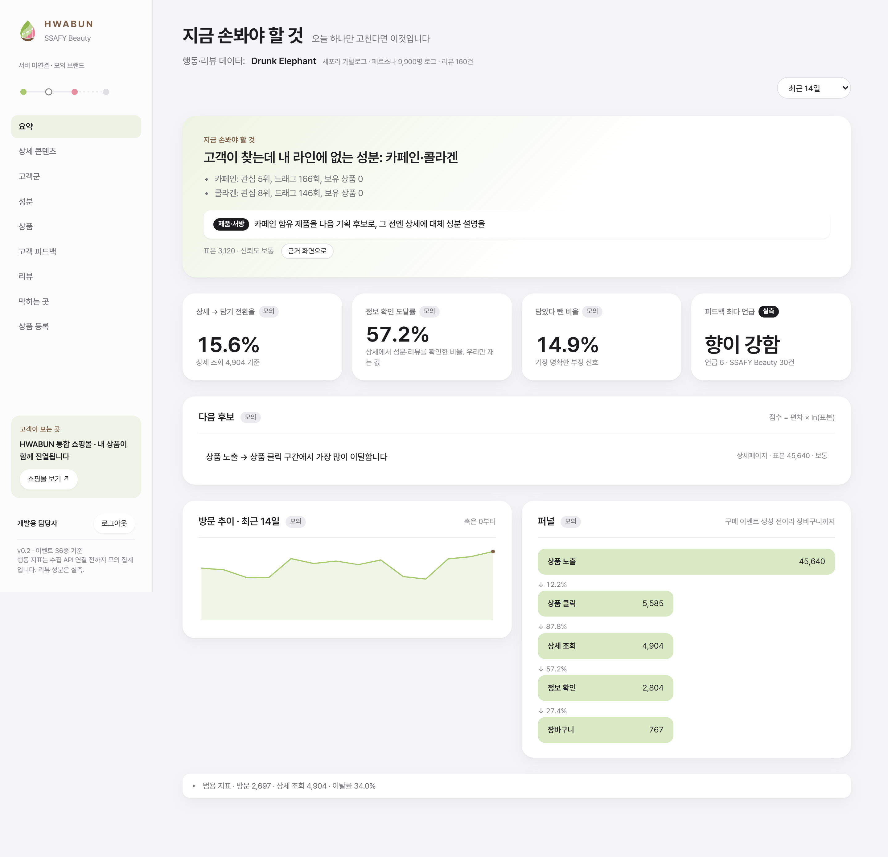
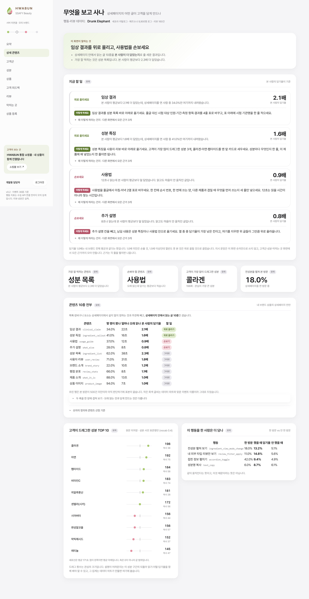
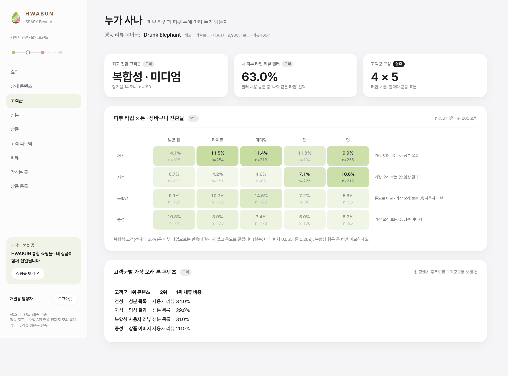
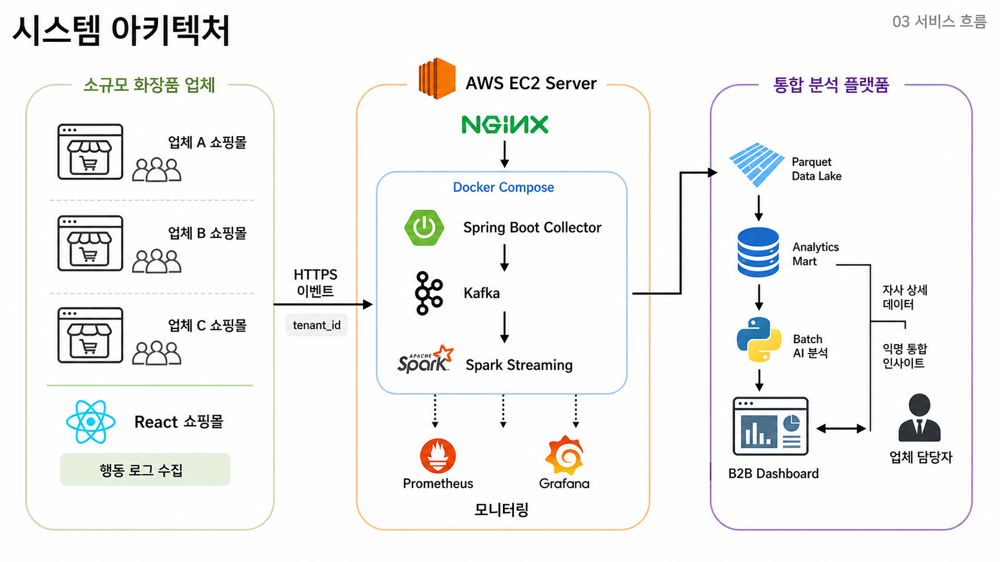

# 화분 (HWABUN)

> 여러 소규모 뷰티 브랜드를 한 쇼핑몰에 모아 소비자에게 맞춤 추천하고, 브랜드에는 고객 피드백과 교차 브랜드 인사이트를 돌려주는 참여형 뷰티 커머스 플랫폼


## 프로젝트 소개

소규모 뷰티 브랜드는 고객 의견을 제품에 반영하고 팬덤을 만들 시간도 도구도 없습니다. 화분은 그 일을 플랫폼 기능으로 만들었습니다.

- **소비자**는 쇼핑몰 BLOOM 하나에서 회원가입 한 번으로 여러 브랜드를 둘러보고, 자기 피부 고민에 맞는 상품을 추천받고, 써 본 뒤 피드백으로 제품 개선에 참여합니다.
- **브랜드 사장님**은 대시보드에서 자기 상품 성과와 고객 반응을 봅니다. 혼자서는 알 수 없는 교차 브랜드 유입, 유사 브랜드 대비 전환율, 구매 이유 분포까지 볼 수 있습니다.

여러 브랜드를 모으는 이유는 둘입니다. 한 브랜드만으로는 추천 후보가 부족해 알고리즘이 의미를 갖기 어렵고, 모여 있어야 "다른 브랜드를 보던 고객이 우리에게 왔다"는 인사이트가 나옵니다.

## 주요 성과

| 항목 | 결과 |
| --- | --- |
| 최종 발표회 | 서울 3반 **1위** |
| 추천 정확도 | 홀드아웃 10,400명 Recall@10 **42.8 ~ 44.2%** (세트 a·b·c), 인기순 기준선 대비 약 **1.8 ~ 4배** |
| 수집 처리량 | 수집기 경유 **16,000 이벤트/초**를 10분간 지속, 거절 0건 |
| 데이터 규모 | 페르소나 9,900명 합성 행동 로그 약 **1,049만 건**, LLM 에이전트 100명의 실제 브라우저 조작 |
| 품질 검증 | Spark 파이프라인 품질 검사 **171개** 자동 실행 |

## 화면

| 쇼핑몰 BLOOM | 상품 상세 |
| --- | --- |
|  |  |

| 브랜드 대시보드 요약 | 상세페이지 처방 |
| --- | --- |
|  |  |

| 고객군 | 고객 피드백 |
| --- | --- |
|  |  |

## 주요 기능

### 소비자 · 쇼핑몰 BLOOM
- 여러 브랜드 상품 목록·상세·장바구니·주문, PortOne(카카오페이) 결제
- 피부 타입·고민·선호를 반영한 **맞춤 추천 카드 10개**와 신규 브랜드 히어로 배너
- 구매자만 쓰는 리뷰, 축을 고르는 구조화된 **제품 피드백**

### 브랜드 · 대시보드 (메뉴 8개 · 화면 13개)
- 요약 · 상세페이지 · 상품 · 주문 · 고객 · 고객의 말 · 시장 · 상품 등록
- 상세페이지에서 이탈이 생기는 지점과 고칠 점을 알려 주는 **AI 처방 문장**과 화면별 한 마디
- 교차 브랜드 유입, 유사 브랜드 대비 전환율, 구매 이유 분포, 성분 관심 추이
- 상품을 등록하면 바로 추천 후보에 편입

### 데이터 · AI
- 직접 설계한 행동 로그 **43종** → Kafka → Spark 5단계(Q1~Q5) → 마트 25종 → DW
- 콘텐츠 기반 + 협업 필터링을 **LTR(학습 결합)** 로 묶은 추천, Kafka 구독으로 세션 상태 실시간 반영
- 고객 피드백 자동 분류(5축 20종, 사람 정답 50건 대비 F1 94.3)

## 아키텍처



```
 ① 행동                ② 수집                ③ 분산 처리                 ④ 서빙·분석              ⑤ 소비
 ──────────            ──────────            ─────────────               ─────────────            ─────────
 실제 소비자                                                              추천 서버 8300           쇼핑몰 BLOOM
   │                   수집 서버 8080         Kafka activity-events       · items 10 + hero       · 추천 카드
 페르소나 9,900명 ────▶ POST /api/events ──▶  파티션 3 · key=session_id ──▶ · 실시간 상태 반영  ──▶ · 신규 브랜드 히어로
   │  (생성기)           검증 → Kafka           │                          · 처방 문장(LLM)
 에이전트 100명          백프레셔 429/503       ▼                          · 상품 등록 즉시 편입    브랜드 대시보드
   (Playwright+LLM)                          Spark Q1~Q5                        ▲                 · 13개 화면
                                              Q1 raw_sink   (상시)              │                 · 마트 API 11개
 세 갈래가 같은 스키마                          Q2 clean_events                   │
 frontend/src/types/log.ts (43종)              Q3 derive_facts                 DW MySQL
                                               Q4 build_marts  → 마트 25종      24 테이블
                                               Q5 validate     (검사 171개)      ▲
                                                     │                          │
                                                     └── dw projection ─────────┘
                                                         staging→검증→원자적 스왑

 쇼핑몰 백엔드 8090 (MySQL)  JWT 로그인 · 브랜드 · 상품 등록 · 주문 · 결제 · 리뷰 · 피드백 · 정산 · 판매자 대시보드
 운영  EC2-1  nginx(443) · shop-backend · mysql · backend · recommend · Prometheus · Grafana
       EC2-2  Kafka(KRaft) · Spark master/worker/history · Q1 상시 · 일일 배치(03:00 KST)
```

실제 소비자와 LLM 에이전트는 진짜 브라우저에서 프론트 로거를 타고, 페르소나는 생성기가 수집기와 같은 봉투를 채워 보냅니다. 세 갈래가 같은 이벤트 스키마를 쓰기 때문에 Q2 아래로는 구분 없이 흐르고, 필요할 때만 `actor_type` 과 `generator_type` 으로 갈라 봅니다.

## 기술 스택

| 영역 | 기술 |
| --- | --- |
| 프론트엔드 | React 19 · TypeScript 6 · Vite 8 · oxlint · PortOne Browser SDK |
| 쇼핑몰 백엔드 | Spring Boot 4.1 · Java 21 · JPA · Spring Security · jjwt · MySQL 8.4 |
| 수집 서버 | Spring Boot 4.1 · Spring Kafka · Micrometer(Prometheus) · springdoc-openapi |
| 메시징 · 분산 처리 | Apache Kafka 4.2 (KRaft) · Spark 3.5 Structured Streaming / Batch · Parquet · PyArrow |
| 추천 · AI | Python 3.13 · NumPy · scikit-learn(HistGradientBoosting LTR) · FastAPI · confluent-kafka · sentence-transformers · GPT-4.1-mini(SSAFY GMS) |
| 시뮬레이터 | Python 행동 로그 생성기 · Playwright(Chromium) + LLM 에이전트 |
| 인프라 · 운영 | AWS EC2 2대 · Docker Compose · nginx · certbot · Jenkins · Prometheus · Grafana |
| 데이터셋 | Sephora 리뷰 844,865건 · 상품 200개(+ 등록 상품) · 페르소나 9,900명 + 평가용 홀드아웃 10,400명 |

Sephora 데이터를 쓴 이유는 여러 브랜드가 한 쇼핑몰에 섞여 있어 우리 추천 환경(통합몰)과 가장 가깝기 때문입니다.

## 추천 모델

- **상품 벡터 148차원.** 카테고리·피부 고민·성분·클린·제형·가격대·브랜드 멀티핫 블록 8종과 평점. 블록 가중치는 문서 빈도에서 계산합니다.
- **점수.** 콘텐츠 유사도에 페르소나 속성 친화도(4,000행)와 상품 동시발생 CF(200×200)를 더해 LTR로 결합합니다. 트리 382개·피처 20개, 학습 9,900명 383,967행. 학습과 서빙이 같은 피처 코드(`ltr_features.py`)를 씁니다.
- **노출 정책.** MMR 다양성, 신규 브랜드 전용 슬롯, 콜드스타트 폴백.
- **평가.** 오프라인 leave-last-out · 리뷰 이력 순차 재생 · 동적 시뮬레이션 세 축으로 나누고, 홀드아웃 3세트(a·b 2,000명, c 6,400명)로 "a에서 고르고 b에서 확인"했습니다.

| 방법 (holdout_a 2,000명) | Recall@10 |
| --- | ---: |
| **화분 LTR** | **43.80%** |
| 인기순 + 구매 브랜드 우선 | 24.85% |
| 인기순 (리뷰 수) | 10.80% |
| 인기순 (찜 수) | 7.15% |

최종 모델(382트리)의 세트별 값은 a 43.45% · b 42.75% · c 44.16% 입니다. 자세한 실험 기록은 [`docs/ai/evaluation-framework.md`](docs/ai/evaluation-framework.md) 에 있습니다.

## 팀

| 이름 | 역할 | 담당 |
| --- | --- | --- |
| 강하린 | 기획 (PM) | 서비스 기획·브랜딩, 일정·업무 관리, 발표 자료·홍보 영상 |
| 추유림 | 프론트엔드 | 쇼핑몰·브랜드 대시보드·운영 화면, 행동 로거와 수집 훅 43종, 대시보드 지표 설계 |
| 최열음 | 백엔드 | 수집 서버, 쇼핑몰 백엔드(도메인 13개·테이블 38개), Jenkins CI/CD, 모니터링 |
| 이은솔 | 데이터 | Spark Q1~Q5 파이프라인, 마트 25종, 품질 검증 171개, 팀 계약 문서 |
| 송민우 | 인프라 | EC2-2 Kafka·Spark 구축, 일일 배치 자동화, DW projection(원자적 스왑) |
| 박규원 | AI | 추천 모델·추천 서버, 행동 로그 생성기·LLM 에이전트, 피드백 분류, 처방 문장 |

## 실행

### 로컬 전 구간

```bash
# 1. 공용 네트워크 + Kafka + Spark
bash infra/create-network.sh
docker compose -f infra/kafka/docker-compose.yml -f infra/spark/docker-compose.yml \
  up -d --build --wait kafka spark-master spark-worker spark-history

# 2. Q1 상시 가동 (Kafka → Raw Parquet)
pwsh infra/spark/run-pipeline.ps1 -Action start-q1      # bash: infra/spark/run-pipeline.sh

# 3. 로그를 흘려보낸 뒤 Q1 을 세우고 Q2~Q5 배치
pwsh infra/spark/run-pipeline.ps1 -Action stop-q1
pwsh infra/spark/run-pipeline.ps1 -Action run-batch

# 4. 추천 서버
python -m uvicorn batch.serving.recommend_server:app --host 127.0.0.1 --port 8300

# 5. 프론트
cd frontend && npm install && npm run dev               # 5173
```

`infra/spark/.env.example` 을 `.env` 로 복사해 씁니다(`COMMONS_HASH_SALT` 필수). 서버 배포는 [`exec/1_포팅_매뉴얼.md`](exec/1_포팅_매뉴얼.md) 를 따릅니다.

### 행동 로그 생성

```bash
python simulator/generator/gen_behavior_logs.py --limit 1000 --currency KRW --out <경로>
python simulator/generator/demo_live.py --limit 9900      # Kafka 로 흘려보내기
```

### 테스트

```bash
python -m pytest batch/ contracts/ simulator/     # AI·계약·시뮬레이터
python -m pytest streaming/tests                  # Spark (pyspark 필요)
cd backend && ./gradlew test                      # 수집 서버
cd shop_backend && ./gradlew test                 # 쇼핑몰 백엔드
```

## 폴더 구조

```
hwabun/
├── frontend/       React 쇼핑몰 · 브랜드 대시보드 · 운영 화면, 행동 로거
├── backend/        Spring Boot 수집 서버 (8080)
├── shop_backend/   Spring Boot 쇼핑몰 백엔드 (8090) + MySQL
├── streaming/      Spark Q1~Q5 + DW projection
├── batch/          추천 배치 · 모델 · 평가, 추천 추론 서버 (8300)
├── simulator/      페르소나 행동 로그 생성기 · LLM 에이전트
├── contracts/      팀 계약 (이벤트 스키마 · DW 스키마 · 추천 입출력 · 어휘집)
├── deploy/         EC2-1 · EC2-2 배포 구성
├── infra/          로컬 Kafka · Spark 환경
├── monitoring/     Prometheus · Grafana
├── exec/           포팅 매뉴얼 · 외부 서비스 정보 · DB 덤프 · 시연 시나리오
└── docs/           기획 · 행동 로그 · DW · 추천 · 대시보드 설계 문서
```

## 문서

| 궁금한 것 | 문서 |
| --- | --- |
| 서비스 기획 | [`docs/planning/service-plan.md`](docs/planning/service-plan.md) |
| 어떤 이벤트를 왜 그 자리에 두었나 | [`docs/analytics/behavior-log-design.md`](docs/analytics/behavior-log-design.md) |
| 이벤트 속성·enum 규칙 | [`contracts/event-properties-schema.md`](contracts/event-properties-schema.md) |
| 마트 grain·컬럼 | [`contracts/dw-schema.md`](contracts/dw-schema.md) |
| 추천 점수는 어떻게 나오나 | [`docs/ai/recommendation-design.md`](docs/ai/recommendation-design.md) · [`contracts/recommendation-io-spec.md`](contracts/recommendation-io-spec.md) |
| 추천을 어떻게 평가했나 | [`docs/ai/evaluation-framework.md`](docs/ai/evaluation-framework.md) |
| 대시보드 지표 산출 근거 | [`docs/dashboard/metric-basis.md`](docs/dashboard/metric-basis.md) |
| 쇼핑몰 API | [`docs/api-spec.md`](docs/api-spec.md) |
| 배포 | [`exec/1_포팅_매뉴얼.md`](exec/1_포팅_매뉴얼.md) |
