# 화분 (HWABUN)
**소규모 뷰티 브랜드를 위한 통합 쇼핑몰 · 행동 로그 분석 · 맞춤 추천 플랫폼**

여러 소규모 화장품 브랜드를 한 쇼핑몰에 모아, 소비자에게는 피부 고민에 맞는 상품을 추천하고
브랜드에는 혼자서는 볼 수 없던 고객 행동과 업계 비교 인사이트를 대시보드로 돌려줍니다.

> SSAFY 15기 특화 프로젝트 · 2026.08.27 ~ 2026.10.02 · **최종 발표회 서울 3반 1위**

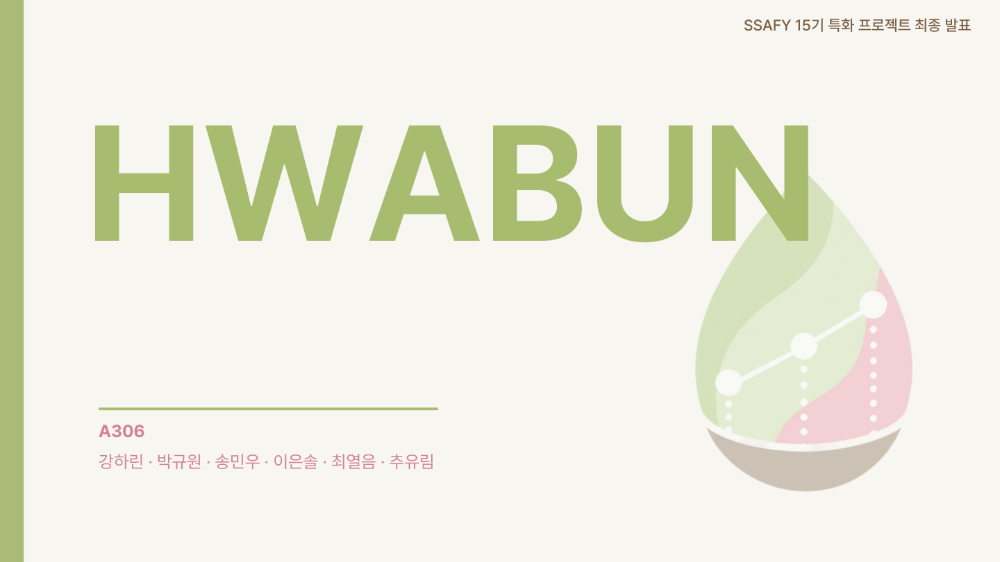

## 기획 배경

K-뷰티 수출은 2025년 114억 달러로 세계 2위에 올랐고, 그중 72.5%를 소규모 브랜드가 만듭니다.
하지만 소규모 브랜드는 진입이 2배 늘 때 폐업이 10배 늘었습니다. 고객이 무엇을 보고 왜 떠나는지 알 데이터도, 분석할 인력도 없기 때문입니다.

화분은 이 문제를 **함께 쓰는 분석 인프라**로 풉니다.

- **한 쇼핑몰에 모읍니다.** 브랜드 하나로는 추천 후보도, 비교할 기준도 부족합니다. 모여 있어야 "다른 브랜드를 보던 고객이 우리에게 왔다"는 인사이트가 나옵니다.
- **행동을 기록합니다.** 구매만이 아니라 스크롤 깊이, 머문 섹션, 담았다 뺀 상품까지 직접 설계한 43종의 행동 로그로 남깁니다.
- **브랜드에 돌려줍니다.** 그 로그를 분산 처리해 브랜드 대시보드와 개인화 추천으로 되돌려 줍니다.

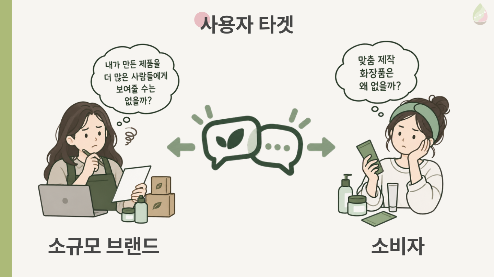

## 주요 기능

### 브랜드 대시보드

메뉴 8개 · 화면 13개. 사장님이 묻는 질문 순서대로 판매, 업계 비교, 이탈 지점, 고객 행동을 보여 줍니다.

<table>
  <tr>
    <td align="center">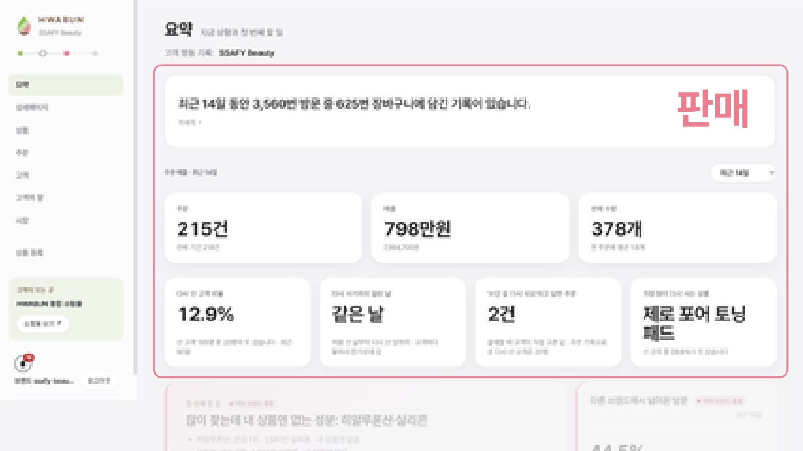</td>
    <td align="center">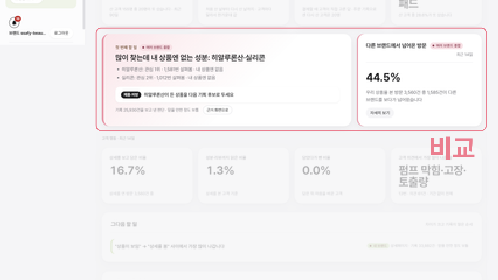</td>
  </tr>
  <tr>
    <td align="center"><b>판매 요약</b> 방문·장바구니·주문·재구매를 한 화면에</td>
    <td align="center"><b>업계 비교</b> 유사 브랜드 대비 전환율과 교차 브랜드 유입</td>
  </tr>
  <tr>
    <td align="center">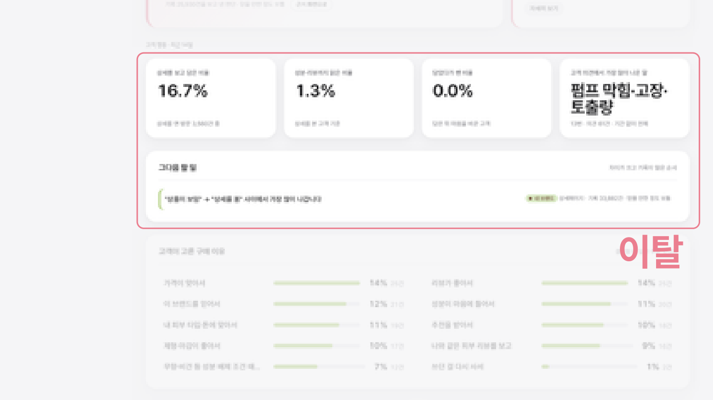</td>
    <td align="center">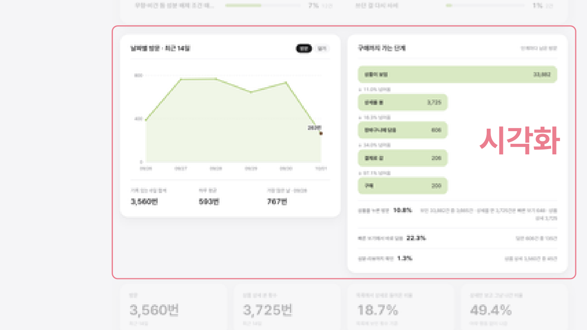</td>
  </tr>
  <tr>
    <td align="center"><b>이탈 분석</b> 상세페이지 어디서 떠나는지와 AI 처방 문장</td>
    <td align="center"><b>시각화</b> 기간별 퍼널과 고객 행동 추이</td>
  </tr>
</table>

### 쇼핑몰 BLOOM과 개인화 추천

회원가입 한 번으로 여러 브랜드를 둘러보고, 피부 타입·고민·행동을 반영한 추천 카드 10개와 신규 브랜드 배너를 받습니다.
결제(PortOne · 카카오페이), 구매자 리뷰, 축을 골라 남기는 제품 피드백까지 이어집니다.

### 실시간 처리

소비자의 클릭 하나가 Kafka를 거쳐 초 단위로 추천 서버의 세션 상태에 반영됩니다.

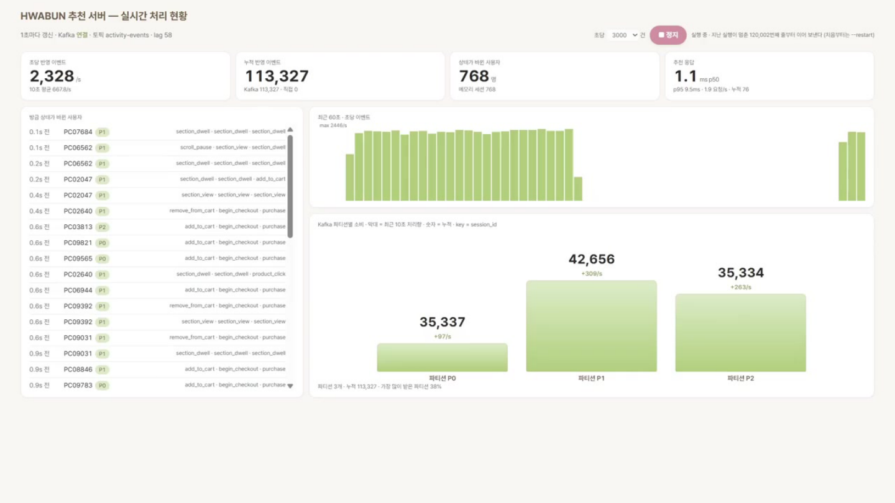

## 핵심 기술

### 서비스 플로우

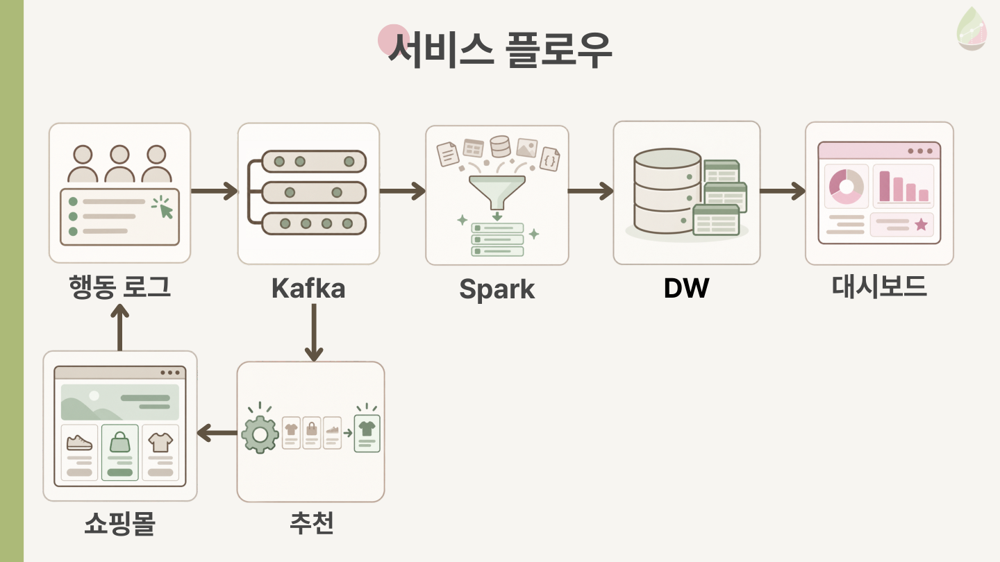

| 단계 | 내용 |
| --- | --- |
| 행동 로그 | 직접 설계한 이벤트 43종(`add_to_cart`, `hover_dwell`, `scroll_depth` …). 프론트·생성기·에이전트가 같은 스키마 사용 |
| Kafka | 토픽 `activity-events`, 파티션 3개, key = `session_id`. 수집 서버가 검증 후 produce, 과부하 시 429/503 백프레셔 |
| Spark | Q1 원본 적재(상시) → Q2 정제·중복 제거 → Q3 세션화·Fact → Q4 마트 25종 → Q5 품질 검증 171개 |
| DW | Parquet 마트를 MySQL로 발행. staging 적재 → 검증 → RENAME 원자적 교체 |
| 추천 | CBF + CF를 LTR로 결합, Kafka 구독으로 세션 상태 실시간 반영 |

### 가상 소비자 10,000명

실제 사용자가 없는 상황에서 파이프라인과 추천을 검증하려고, 실제 Sephora 리뷰어의 구매 이력을 바탕으로 가상 소비자를 만들었습니다.

- **페르소나 9,900명** · 생성기가 성향 6축에 따라 행동 로그 약 1,049만 건을 생성
- **LLM 에이전트 100명** · Playwright로 실제 브라우저를 띄워 쇼핑몰을 직접 조작

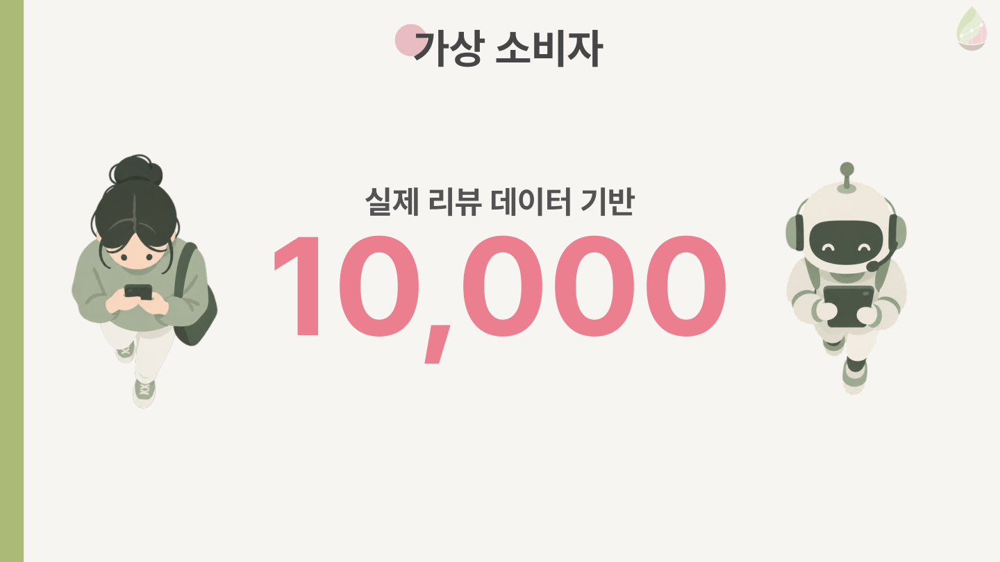

### 추천 성능

실제 리뷰어의 구매 이력 중 앞부분(SEED)으로 추천하고, 마지막에 실제로 산 상품(Target)이 추천 10개 안에 드는지(Recall@10)로 쟀습니다.
CBF 23.4% → CF 결합 38.2% → LTR 결합 **43.8%**, 인기순 추천(10.8%)의 약 4배입니다.

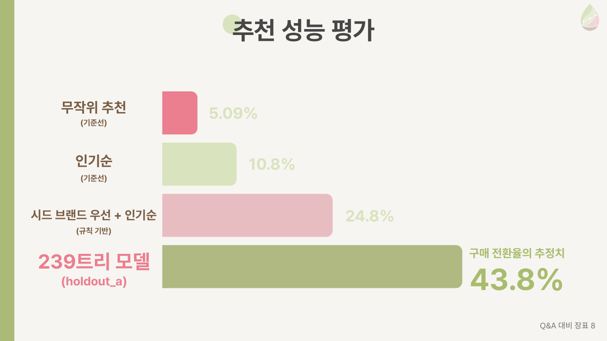

### 부하 테스트

목표 2,000 TPS(올리브영 앱 사용자 규모로 산정한 초당 최대 이벤트 수)에 대해 수집기 경유 **16,000 이벤트/초**를 10분간 지속, 거절 0건을 확인했습니다.

<table>
  <tr>
    <td align="center">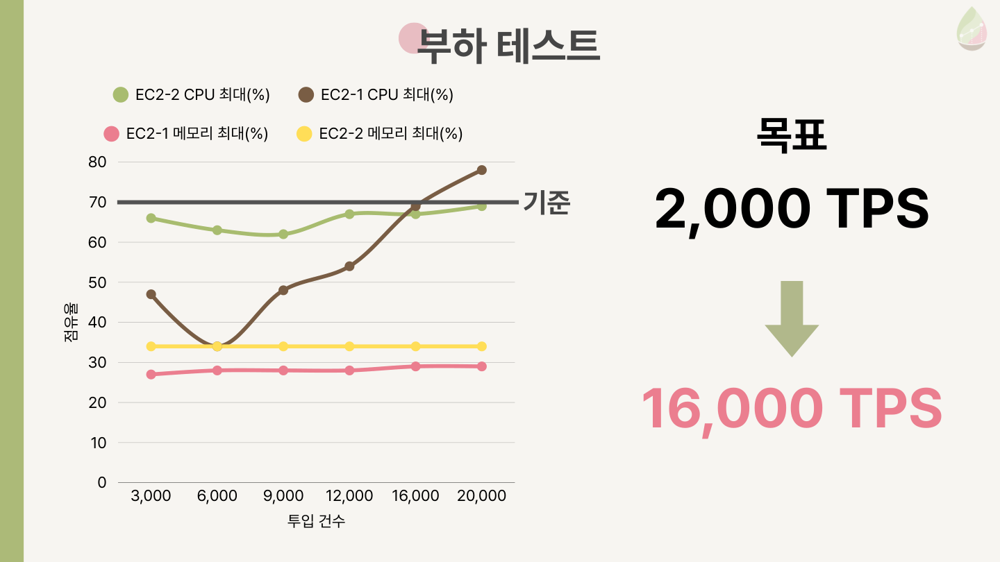</td>
    <td align="center">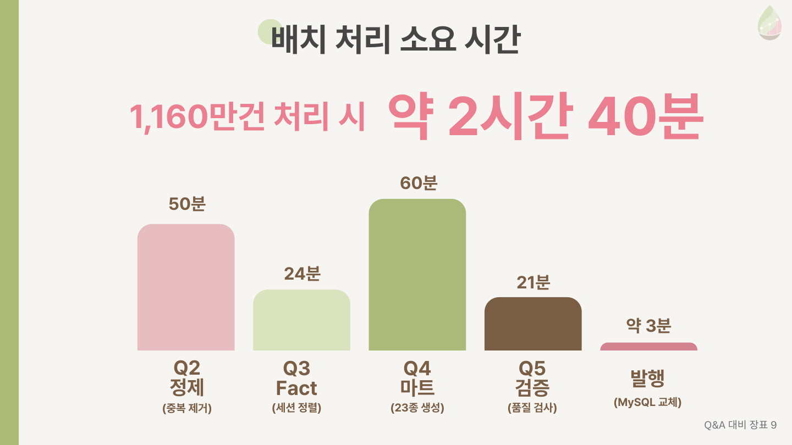</td>
  </tr>
  <tr>
    <td align="center"><b>부하 테스트</b> 목표 2,000 TPS → 16,000 TPS</td>
    <td align="center"><b>배치 처리 시간</b> 1,160만 건 Q2~Q5 + 발행 약 2시간 40분</td>
  </tr>
</table>

## 기술 스택

| 영역 | 사용 기술 |
| --- | --- |
| Frontend | React 19, TypeScript 6, Vite 8, PortOne Browser SDK |
| Backend | Java 21, Spring Boot 4.1, Spring Security, JPA, jjwt, MySQL 8.4, Spring Kafka |
| Data | Apache Kafka 4.2 (KRaft), Spark 3.5 Structured Streaming / Batch, Parquet, PyArrow |
| AI | Python 3.13, scikit-learn(HistGradientBoosting LTR), FastAPI, confluent-kafka, sentence-transformers, GPT-4.1 (SSAFY GMS), Playwright |
| Infra | AWS EC2 2대, Docker Compose, Nginx, Jenkins, Prometheus, Grafana |
| Dataset | Sephora 리뷰 84만 건 · 상품 200개 |

각 영역의 실행 방법은 [exec](exec/1_포팅_매뉴얼.md)를 참고하세요.

## 시스템 아키텍처

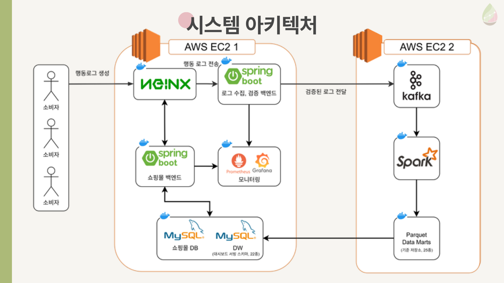

- **EC2-1** · Nginx, 수집 서버, 쇼핑몰 백엔드, 추천 서버, MySQL(쇼핑몰 DB · DW), Prometheus · Grafana
- **EC2-2** · Kafka(KRaft), Spark master/worker/history, Q1 상시 적재, 일일 배치(03:00 KST)

## 팀원

| 이름 | 역할 | 담당 |
| --- | --- | --- |
| 강하린 | PM | 서비스 기획·문제 정의, 발표 스토리라인·일정 관리, 영상 포트폴리오 |
| 박규원 | AI | 추천 알고리즘(CBF·CF·LTR), 실시간 추천 서버, 페르소나 생성기·LLM 에이전트 |
| 송민우 | Infra | EC2 2대 구축, Kafka·Spark 운영, 일일 배치 자동화, DW 발행 |
| 이은솔 | Data | Spark 파이프라인 Q1~Q5, 마트 25종·품질 검증, 데이터 계약 |
| 최열음 | Backend | 로그 수집 서버, 쇼핑몰 백엔드, Jenkins CI/CD, 모니터링 |
| 추유림 | Frontend | 쇼핑몰 BLOOM, 브랜드 대시보드, 행동 로그 43종 설계 |

## Repository

- `frontend/`: React 쇼핑몰 · 브랜드 대시보드 · 운영 화면, 행동 로거
- `backend/`: Spring Boot 로그 수집 서버
- `shop_backend/`: Spring Boot 쇼핑몰 백엔드
- `streaming/`: Spark Q1~Q5, DW 발행
- `batch/`: 추천 모델·평가, FastAPI 추천 서버
- `simulator/`: 페르소나 행동 로그 생성기, LLM 에이전트
- `contracts/`: 이벤트·DW·추천 입출력 계약
- `deploy/` · `infra/` · `monitoring/`: 배포, 로컬 Kafka·Spark, 모니터링
- `docs/`: 기획·행동 로그·DW·추천·대시보드 설계 문서

## Documents

- [서비스 기획](docs/planning/service-plan.md)
- [행동 로그 설계](docs/analytics/behavior-log-design.md)
- [DW 스키마](contracts/dw-schema.md)
- [추천 설계](docs/ai/recommendation-design.md) · [추천 평가](docs/ai/evaluation-framework.md)
- [대시보드 지표 근거](docs/dashboard/metric-basis.md)
- [포팅 매뉴얼](exec/1_포팅_매뉴얼.md)
