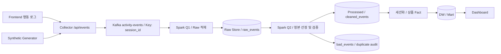

# Kafka 구조 및 이벤트 처리 명세

- 작성자: 송민우 / Backend & Infra
- 작성일: 2026-08-31
- 문서 버전: 0.1
- 상태: 팀 리뷰용 초안
- 구현 확인 기준: `origin/dev`의 `e0faea4` 커밋

이 문서는 Collector에서 Kafka로 이벤트를 발행하고, Spark를 통해 Raw와 Processed를 만드는 경계를 정의한다. Kafka 설정 파일, Cluster 배포, Spark Job은 이번 문서 작업에 포함하지 않는다. 아래의 제안값은 서버에 적용된 값이나 측정 결과가 아니다.

## 1. 범위와 표기

| 표기 | 의미 |
| --- | --- |
| 구현 확인 | 현재 저장소의 코드 또는 설정에서 확인한 동작 |
| 기존 계약 | Raw/Processed/DW 문서에 기록된 합의 |
| 설계 제안 | 이 명세에서 제안하며 구현·팀 검토가 필요한 정책 |
| 미정 | 입력 조건이나 검증 결과가 없어 아직 확정하지 않은 항목 |

Kafka는 수집과 처리 사이의 전달·버퍼·재생 구간을 맡는다. 영구 Raw 저장소, Processed 정본 테이블, DW 저장 엔진은 Kafka와 별개다.

설계 범위는 Topic, 메시지 계약, Partition, Producer 보장 범위, Raw/Processed 중복 처리, Spark 복구, 관측 지표 및 검증 기준이다. 개별 마케팅 KPI 산식과 Event Taxonomy 전체는 데이터 담당 문서를 따른다.

## 2. 현재 구현 기준선

| 항목 | 구현 확인 내용 |
| --- | --- |
| 수집 API | `POST /api/events` |
| HTTP 본문 | `{ "schema_version": "...", "events": [...] }` |
| 요청 크기 | 이벤트 1~100건. HTTP 본문 바이트 상한은 별도 결정 필요 |
| Front 배치 트리거 | 20건 또는 5초 중 먼저 도달한 조건 |
| Front 재시도 배치 | 요청당 최대 100건으로 분할. 메모리 큐 상한은 1,000건 |
| Kafka Topic 기본값 | `activity-events` |
| Kafka 메시지 단위 | HTTP 배열을 펼쳐 Event 1건당 메시지 1개 |
| Kafka Key | 필수 필드인 `session_id` |
| 직렬화 | Key와 Value 모두 StringSerializer. Value는 JSON |
| Topic 생성 | 기본 비활성화. 인프라에서 미리 생성하는 방식 |
| 로컬 Topic 생성 옵션 | 활성화 시 Partition 기본값 3개, Replication Factor 1 |
| 서버 추가 필드 | `received_at`, `source`, `request_id`, `event_index` |
| 성공 응답 | 배치의 모든 Kafka 전송 Future가 성공하면 HTTP 202 |
| 검증 오류 | 현재는 일부 항목만 제외하지 않고 배치 전체 HTTP 400 |
| 발행 오류 | Kafka 전송 실패 또는 전용 실행기 포화 시 HTTP 503 |
| Spark 구현 | Q1~Q4 Raw·Processed·Fact·Mart MVP 및 파이프라인 불변식 검증 Job 구현 |
| 모니터링 | Collector용 Prometheus/Grafana 구성이 있음 |

근거: [Backend README](../backend/README.md), [API 요청 DTO](../backend/src/main/java/com/cosmetic/collector/event/api/EventBatchRequest.java), [Collector API](../backend/src/main/java/com/cosmetic/collector/event/api/EventController.java), [Producer](../backend/src/main/java/com/cosmetic/collector/event/infrastructure/KafkaEventPublisher.java), [Topic 생성 설정](../backend/src/main/java/com/cosmetic/collector/config/KafkaTopicConfig.java), [Front Logger](../frontend/src/lib/logger.ts).

`ACTIVITY_EVENTS_PARTITIONS=3`은 로컬 Topic 생성에 사용할 기본값이다. 이미 존재하는 Broker의 실제 Partition 수를 보증하거나 실행 중 Topic을 자동 변경하는 설정은 아니다.

## 3. 전체 데이터 흐름

다음은 목표 구조다. Collector까지는 코드가 있으며, Raw 이후 Job과 저장소 연결은 구현 대상이다.



설계 제안은 Raw를 먼저 영속화하고, 정제 Job이 Raw를 읽는 두 단계 구조다. 분석 로직을 수정해도 Kafka 보존 기간에만 의존하지 않고 Raw에서 다시 계산하기 위해서다.

| 구간 | 책임 | 하지 않는 일 |
| --- | --- | --- |
| Front / Simulator | 공통 Envelope 생성, 재시도 시 같은 이벤트 ID 유지 | Kafka 직접 접속 |
| Collector | 요청 검증, 서버 메타 추가, Kafka 발행 결과를 HTTP로 반환 | 분석 집계, 업무 이벤트 중복 제거 |
| Kafka | 이벤트 보관, Partition별 로그 제공, 소비 속도 차이 흡수 | DW 정본 판정 |
| Raw Job | Kafka 원문과 출처 메타를 재처리 가능하게 저장 | 같은 `event_id`를 하나로 축소 |
| Processed Job | 정본 선정, 의미 검증, 타입 정규화, 품질 기록 | 수신 원문 덮어쓰기 |
| DW / Mart | 중복 제거된 Processed 데이터로 집계 | Raw를 직접 세어 KPI 생성 |

Q1과 Q2를 하나의 Job으로 합칠지는 저장 엔진과 트랜잭션 방식 검증 후 결정한다. 여러 Sink를 한 `foreachBatch`에서 호출한다고 자동으로 원자적 저장이 되는 것은 아니므로, 각 Sink의 멱등성과 부분 성공 후 재실행을 따로 검증한다.

## 4. Topic과 메시지 계약

### 4.1 Topic 구성

| 논리 데이터 | Kafka Topic / 저장 위치 | 상태 |
| --- | --- | --- |
| 수신 행동 이벤트 | `activity-events` | 현재 Producer 기본값 유지 |
| 수신 원문 | `raw_events` Raw Dataset | 기존 계약. Topic 이름과 구분 |
| 정제된 이벤트 | `cleaned_events` Processed Dataset | 기존 계약. 별도 Kafka Topic 생성은 이번 범위 아님 |
| 파싱·의미 검증 오류 | `bad_events` Dataset | 저장 구현 필요 |
| 중복·ID 충돌 추적 | 감사 Dataset 또는 View | 설계 제안 |
| 별도 DLQ Topic | 필요 시 후속 설계 | 이번 초안에서는 생성하지 않음 |

현재 Event들은 공통 Envelope와 소비 경로를 공유하므로 초기에는 단일 입력 Topic을 사용한다. `product_view`, `product_click`, `add_to_cart` 등은 `event_name`으로 구분한다. 보존 기간, 접근 권한 또는 소비 부하를 독립적으로 운영해야 할 때 Topic 분리를 검토한다.

환경은 별도 Cluster로 격리하는 것을 우선한다. Cluster를 공유한다면 환경별 Topic 이름을 사용하고 `ACTIVITY_EVENTS_TOPIC`에 명시한다. 부하 테스트는 실사용 트래픽과 자원을 격리하며, 같은 Schema를 유지하고 `actor_type`, `source`, `simulation_run_id`로 표본을 구분한다.

### 4.2 Kafka Value 예시

아래는 Collector가 서버 필드를 추가한 Event 1건의 예시다. HTTP 요청에서는 서버 추가 필드를 전달하지 않는다.

```json
{
  "schema_version": "0.2.0-draft",
  "event_id": "5b58ca1e-3299-4d51-a08d-a19f605a5c68",
  "event_name": "product_click",
  "intent": "comparison",
  "occurred_at": "2026-08-31T01:00:00.000Z",
  "persona_id": null,
  "session_id": "session-001",
  "page_view_id": "page-view-001",
  "sequence_no": 1,
  "page_type": "product_list",
  "product_id": "P342",
  "actor_type": "user",
  "environment": "local",
  "received_at": "2026-08-31T01:00:00.120Z",
  "source": "web",
  "request_id": "0ab9643f-0c78-40bc-b477-0a7e2b4d6cad",
  "event_index": 0,
  "properties": {
    "position": 1
  }
}
```

이 메시지의 Kafka Key는 문자열 `session-001`이다. Event 이름은 현재 계약인 `lower_snake_case`를 사용하며, 초기 구상에서 사용한 대문자 `PRODUCT_VIEW`는 실제 API 예시에 사용하지 않는다.

### 4.3 식별자와 시각의 의미

| 필드 | 기준 |
| --- | --- |
| `event_id` | 논리적 행동 1건의 ID. 재전송 시 유지하고, 별개의 행동에는 새 ID 부여 |
| `session_id` | 방문 단위 식별자이며 Kafka Key. `persona_id`가 null이어도 유지 |
| `sequence_no` | 세션 내부의 클라이언트 발생 순번. 정렬 복원용 |
| `occurred_at` | 클라이언트 발생 시각. 클라이언트 시계 오차 가능 |
| `received_at` | 현재 구현에서는 검증 후 Producer의 `publish()` 진입 시 얻는 서버 시각 |
| `request_id` | HTTP 요청마다 생성. 같은 Event 재시도라도 달라질 수 있음 |
| `event_index` | 해당 HTTP 배열 안의 0부터 시작하는 원본 위치. 부분 수락으로 값 사이에 gap이 있을 수 있음 |
| `source` | 현재 코드에서 `user → web`, `synthetic → simulator`로 생성 |
| `schema_version` | 해석 계약의 버전. 현재 예시 버전은 `0.2.0-draft` |

현재 `received_at`은 배치 전체에 같은 값이 들어간다. HTTP 소켓 도착 시각이나 Kafka Broker 기록 시각과 동일하다고 해석하지 않는다. Collector 여러 대를 운영할 경우 시계 동기화 상태를 확인하고, 시각 비교는 문자열이 아닌 원래 정밀도의 UTC timestamp로 수행한다.

입력 Event의 `occurred_at`과 `received_at`은 RFC 3339의 명시적 offset(`Z`,
`+09:00` 등)을 허용한다. timezone 없는 값은 거부하고, Raw 원문은 보존하되
Parsed/Processed timestamp는 UTC로 정규화한다.

`request_id`와 `event_index`는 추적 정보이며 업무 중복 제거 Key가 아니다. Collector는 배치·Event의 `schema_version` 일치와 일부 활성 Event의 properties 의미를 검증한다. 계약 위반 Event는 Kafka에 발행하지 않으며, HTTP `202` 응답의 `rejections`와 Collector 구조화 로그·메트릭으로 확인한다. `bad_events`는 Kafka에 발행된 Event를 Spark가 추가 검증하다 위반을 발견했을 때만 사용하는 격리 Dataset이다.

근거: [Event DTO](../backend/src/main/java/com/cosmetic/collector/event/api/ActivityEvent.java), [Kafka 메시지 변환](../backend/src/main/java/com/cosmetic/collector/event/infrastructure/KafkaEventMessage.java), [Raw Event 실행 계약](../contracts/event-schema.json), [Event Properties 계약](../contracts/event-properties-schema.md).

## 5. Partition Key와 순서 보장

Key는 실제 구현과 동일하게 `session_id`로 정한다. `persona_id`는 null이 가능하고 한 Persona의 여러 방문을 구분하지 못하므로 이 파이프라인의 Partition Key로 사용하지 않는다. Synthetic seed는 `seed:{simulation_run_id}:{persona_id}:{product_id}` 형식으로 세션을 분리해 모든 Persona의 seed Event가 하나의 Partition으로 쏠리지 않게 한다.

Partition 수와 Partitioner가 고정된 동일 Topic에서는 같은 Key가 같은 Partition으로 향한다. 서로 다른 세션은 같은 Partition에 배치될 수도 있다. 같은 세션을 하나의 로그에 모으는 목적이지, 세션마다 Partition을 하나씩 만드는 방식은 아니다.

Kafka Offset은 해당 Partition의 적재 순서다. Front 배치 재전송이나 Collector 동시 처리로 실제 행동 발생 순서와 달라질 수 있다. 세션 행동 순서는 Processed에서 `session_id + sequence_no`로 복원하고, 순번 충돌·누락은 품질 정보로 남긴다.

Partition 수를 늘리면 같은 Key의 대상 Partition이 달라질 수 있다. 설계 검증 중에는 임의로 Partition 수를 변경하지 않는다. 확장이 필요하면 변경 전후 경계, 진행 중 세션, 기존 Offset과 Checkpoint를 기록하고 새 Topic 전환 또는 통제된 변경 절차를 검토한다. 기존 데이터가 새 Partition으로 자동 재분산된다고 가정하지 않는다.

상품별 집계는 Spark의 집계·재분배 단계에서 수행한다. 상품 집계가 필요하다는 이유만으로 수집 Key를 `product_id`로 바꾸지는 않는다.

## 6. Cluster, 보존 및 용량

### 6.1 환경별 초안

다음 표의 Cluster 구성은 제안이며 실제 배포 상태가 아니다.

| 항목 | 로컬 PoC | 장애 검증용 공유 환경 |
| --- | --- | --- |
| Kafka 모드 | KRaft, Broker/Controller 겸용 1대 제안 | Broker와 Controller 배치 방식 별도 결정 |
| 입력 Partition 수 | 현행 생성 기본값 3개로 시작 | 부하·쏠림·처리 병렬성 측정 후 결정 |
| Replication Factor | 현행 생성 코드 1 | Broker 3대 이상 확보 시 3 제안 |
| `min.insync.replicas` | 1 제안 | RF 3 구성에서 2 제안 |
| `cleanup.policy` | `delete` 제안 | `delete` 제안 |
| `retention.ms` | 24시간을 초기 실험값으로 제안 | 허용 장애 시간·따라잡기 시간·여유분으로 산정 |
| 데이터 볼륨 | 재시작 후 유지되는 로컬 볼륨 | 독립 장애 영역의 영속 디스크 |
| Checkpoint | Job별 경로. 로컬 실험 한정 | 실행 컨테이너와 분리된 영속 저장소 |
| Kafka/Spark 버전 | 미정. 구현 시 호환 버전 고정 | 로컬과 동일 조합부터 검증 |

KRaft Controller는 데이터 복제본과 별개의 메타데이터 합의를 담당한다. Controller 과반수 유지도 함께 설계해야 한다. 한 호스트에 Broker 컨테이너 3개를 띄우는 구성은 호스트 장애에 대한 고가용성을 제공하지 않는다. 실제 운영에서는 역할 분리와 독립 장애 영역을 검토한다. [Kafka KRaft 문서](https://kafka.apache.org/42/operations/kraft/)

`acks=all`은 모든 ISR의 확인을 기다리고, `min.insync.replicas`는 정상 발행에 필요한 ISR 최소 수를 정한다. RF 1에서는 복제본 손실을 견디는 구성이 되지 않는다. Raw Topic에는 Key별 최신 값만 유지하는 Compaction을 적용하지 않는다. Key가 세션이므로 한 세션의 과거 이벤트가 사라질 수 있기 때문이다. [Kafka Topic 설정](https://kafka.apache.org/41/configuration/topic-configs/)

### 6.2 인프라 생성·접근 정책

- 공유 환경의 Topic은 인프라에서 명시적으로 생성하며, 애플리케이션의 자동 생성은 사용하지 않는다.
- Kafka Bootstrap 주소는 환경변수로 주입한다. 호스트 실행 Collector와 컨테이너 실행 Spark가 각각 접근할 수 있는 Listener 주소를 정한다.
- Controller 포트와 Broker 내부 포트는 외부에 공개하지 않는다. 공유 환경은 TLS/SASL 및 Producer 쓰기·Spark 읽기·관리자 권한 분리를 검토한다.
- 애플리케이션 계정에 Topic 삭제 권한을 부여하지 않는다. 비밀번호·인증서는 저장소에 기록하지 않는다.
- 수집 단계의 민감정보 최소화 정책을 Raw 보존보다 먼저 적용한다. Raw 보존을 이유로 불필요한 원문 텍스트를 추가 수집하지 않는다.
- Topic 삭제·재생성은 이력 초기화 작업으로 취급한다. 동일 이름의 Topic을 다시 만들면 Offset을 재사용할 수 있으므로 기존 Raw/Checkpoint와 섞지 않는다.

### 6.3 용량 산정

목표 TPS와 디스크 용량을 측정 결과 없이 확정하지 않는다. 전송 주기 문서에 있는 TPS는 부하 가정이며 실제 처리 성능이 아니다.

```text
필요 디스크의 출발점 =
  보존 구간 평균 Event/s
  × 실측 평균 직렬화 크기(bytes)
  × 보존 시간(s)
  × Replication Factor
  × 실측 저장 크기 보정 및 운영 여유
```

Peak TPS, 큰 Event의 p95/최대 크기, Partition별 쏠림, 재전송량도 별도로 측정한다. Kafka 보존 기간은 Raw 적재 Job의 장애 시간과 복구 후 따라잡는 시간을 감당해야 한다. Raw 장기 보존 기간은 데이터 파트와 별도로 정한다.

`retention.bytes`는 Partition별 한도라는 점과, 시간·용량 조건에 의해 데이터가 만료될 수 있다는 점을 용량 검증에 포함한다. [Kafka 보존 설정](https://kafka.apache.org/41/configuration/topic-configs/)

## 7. Producer와 HTTP 전달 계약

### 7.1 구현된 설정

| 항목 | 현재 값 | 해석 |
| --- | --- | --- |
| `acks` | `all` | Broker의 ISR 조건과 함께 확인해야 함 |
| `enable.idempotence` | `true` | Kafka Producer 내부 재시도 중복 억제 |
| `batch-size` | 65,536 bytes | Producer 전송 배치. HTTP 이벤트 개수와 다른 단위 |
| `compression.type` | `lz4` | 현재 압축 설정 |
| `linger.ms` | 10 | Producer 배치를 모으는 대기 설정 |
| `delivery.timeout.ms` | 10,000 | Producer 전송 완료 제한. HTTP 전체 SLA가 아님 |
| `request.timeout.ms` | 5,000 | Broker 요청 응답 대기 |
| `max.block.ms` | 5,000 | 메타데이터·버퍼 확보를 위한 호출 대기 제한 |
| 전용 실행기 | core 4 / max 16 / queue 0 | 포화 시 새 작업 거절 |

기본값의 출처는 [application.yml](../backend/src/main/resources/application.yml)이다. Producer의 멱등성은 Front가 같은 Event를 다시 HTTP로 제출하는 업무 재전송까지 제거하지 않는다. 따라서 `event_id` 기준 정본 선정이 별도로 필요하다. 이 설정만으로 Front부터 DW까지 Exactly-once를 보장한다고 표현하지 않는다. [KafkaProducer의 보장 범위](https://kafka.apache.org/41/javadoc/org/apache/kafka/clients/producer/KafkaProducer.html)

### 7.2 응답과 재시도

| 상황 | 현재 응답·결과 | 클라이언트 및 후속 처리 기준 |
| --- | --- | --- |
| 모든 Kafka 전송 성공 | 202, `accepted=N`, `rejected=0` | Kafka ACK 완료. Raw/DW 저장 완료 의미는 아님 |
| JSON·공통 필드 검증 실패 | 400, 발행 전 전체 거절 | 수정 없이 무한 재시도하지 않는 정책 필요 |
| 일부 전송 성공 후 실패 | 503 가능, 성공한 메시지는 Kafka에 남을 수 있음 | 배치 재전송 시 같은 `event_id` 유지 |
| Kafka ACK 후 HTTP 응답 유실 | 클라이언트에서는 성공 여부 불명 | 재전송 중복을 Raw에 보존하고 Processed에서 제거 |
| 전용 실행기 포화 | 503 | 제한된 재시도와 Backoff 정책 필요 |
| Front 이탈·큐 상한 초과 | 전송 결과 불명 또는 큐 유실 가능 | Kafka가 받기 전의 유실까지 보장하지 않음 |

현재 발행은 Kafka Transaction으로 배치를 묶지 않는다. 일부 성공을 되돌리는 Rollback이 없으므로 503을 “한 건도 Kafka에 쓰이지 않았다”는 뜻으로 해석하지 않는다.

Front의 현재 메모리 재시도와 1,000건 큐는 영속 전송 보장이 아니다. Beacon 반환값이나 메모리 큐만으로 서버 수신 여부를 입증할 수 없다. 400/503 구분 재시도, 재시도 횟수·Backoff, 긴 장애 시 정책은 연동 과제로 남긴다.

### 7.3 검증 경계

Collector가 거절한 HTTP 요청은 Kafka에 도달하지 않으므로 Kafka Raw Dataset에 자동 보존되지 않는다. Raw 보존 계약의 대상은 Kafka에 수록된 레코드다. HTTP 거절 요청을 별도로 보관하려면 민감정보·용량 정책을 포함한 별도 설계가 필요하다.

Kafka에 들어온 후 확인되는 미등록 Event, 잘못된 `properties`, synthetic 필수 메타 누락 등은 Spark 의미 검증의 대상이다. Synthetic 필수 메타와 Event별 기준은 [Event Properties 계약](../contracts/event-properties-schema.md)을 따른다.

## 8. Raw 보존과 Processed 정본 선정

### 8.1 중복의 두 종류

| 구분 | 예 | 처리 |
| --- | --- | --- |
| 업무 이벤트 재수신 | 같은 `event_id`가 서로 다른 Kafka Offset으로 저장됨 | Raw에 모두 보존, Processed에서 정본 한 건 |
| 소비 재실행 | Checkpoint 복구로 같은 Kafka 레코드를 다시 읽음 | 같은 Raw 수신 기록을 중복 적재하지 않음 |

Raw는 `event_id`를 Unique Key로 사용하지 않는다. 한 Cluster의 유지 중인 Topic을 전제로 `kafka_topic + kafka_partition + kafka_offset`을 수신 레코드 식별자로 사용한다. 여러 Cluster나 재생성된 Topic까지 같은 저장소에 적재할 때는 Cluster/Topic 세대 식별자를 추가해야 한다.

Raw에는 원본 Value를 보존하고, Kafka Key, Topic, Partition, Offset, Kafka timestamp 및 timestamp type을 출처 정보로 함께 기록한다. 파싱 실패 레코드도 원문 보존 후 오류 정보와 연결한다. 여기서 Kafka timestamp는 Collector의 `received_at`과 별개다.

### 8.2 정본 선택 규칙

기존 계약인 `event_id` 기준 중복 제거와 `received_at ASC` 우선순위를 유지한다. Topic 메타데이터가 있는 후보들에 대해 다음 정렬을 제안한다.

```text
업무 Key: event_id

정본 선택 우선순위:
1. received_at ASC
2. kafka_topic ASC
3. kafka_partition ASC
4. kafka_offset ASC
```

입력 Topic이 하나이면 Topic 정렬은 결과에 영향을 주지 않는다. Partition과 Offset은 숫자로 비교한다. `received_at`의 정밀도를 임의로 밀리초로 잘라 동률을 늘리지 않는다.

Partition이 다르면 이 정렬은 실제 전역 도착 순서가 아니라 재실행해도 같은 결과를 얻기 위한 결정적 기준이다. Collector 시계 오차도 고려하므로 “물리적으로 가장 먼저 발생한 행동”이라고 부르지 않고 “계약상 정본”이라고 부른다.

다음 SQL은 유한한 입력 전체를 대상으로 한 검증용 기준이다. 이를 `readStream`에 그대로 실행하는 구현 예시로 사용하지 않는다.

```sql
SELECT *
FROM (
    SELECT
        r.*,
        ROW_NUMBER() OVER (
            PARTITION BY event_id
            ORDER BY
                received_at ASC,
                kafka_topic ASC,
                kafka_partition ASC,
                kafka_offset ASC
        ) AS canonical_rank
    FROM raw_candidates r
) ranked
WHERE canonical_rank = 1;
```

`raw_candidates`는 식별·정렬 필드가 유효하고 해당 처리 범위에 속한 레코드다. `event_id`, `received_at` 또는 출처 식별 정보가 없으면 임의의 현재 시각·랜덤 ID로 보정하지 않고 Raw와 연결된 `bad_events`로 보낸다.

### 8.3 Streaming에서 필요한 추가 처리

단순 `dropDuplicates(event_id)`에는 위 정렬 우선순위에 따른 정본 선택 계약이 없다. 현재 Micro-batch 안에서만 정렬해도 이전 Batch의 후보보다 더 이른 레코드가 나중에 들어오는 문제는 남는다.

제안 구현은 다음과 같다.

1. 신규 Raw 범위에서 Event ID별 최소 정렬 후보를 계산한다.
2. 기존 정본과 새 후보를 같은 정렬 기준으로 비교한다.
3. 더 우선하는 후보만 `event_id` Key로 원자적 Upsert한다.
4. 변경된 정본과 영향을 받는 날짜·Fact를 추적한다.
5. DW는 정본 Key 기반 갱신 또는 해당 집계 범위 재계산을 사용한다.

이 방식에는 원자적 비교·갱신과 멱등 재실행이 가능한 저장소가 필요하다. 일반 파일 Append만으로 이 조건을 충족했다고 보지 않는다. 저장 엔진과 동시 Writer 정책은 Data/Spark 담당자와 확정한다. 최소 PoC의 Console 출력은 이 정본 저장 보장을 검증한 결과가 아니다.

### 8.4 누락 ID, payload 충돌, 의미 오류

- 전송 중복은 클라이언트 Event 내용까지 같은 재전송을 뜻한다. 서버가 추가한 수신 시각·요청 메타만 달라질 수 있다.
- 같은 `event_id`에 다른 클라이언트 payload가 오면 단순 중복과 구분해 ID 충돌로 기록한다. 서버 메타를 제외하고 JSON 키 순서를 정규화한 payload 비교 방식을 검토한다.
- 충돌이 있더라도 정본 우선순위를 임의로 “마지막 것”으로 바꾸지 않는다. 충돌 감사 기록과 알림, 해당 ID의 집계 제외 여부는 데이터 품질 정책으로 확정한다.
- 형식이 유효한 후보 중 계약상 정본을 고른 후 의미 검증을 적용하는 방식을 제안한다. 정본이 의미 검증에 실패하면 `bad_events`로 보내고, 다른 내용의 후속 재전송을 자동으로 정본으로 승격하지 않는다.
- 오류를 수정해 새로운 업무 Event를 발행한다면 ID 발급·정정 정책을 명시한다. 기존 Event의 payload만 바꿔 같은 ID로 덮어쓰지 않는다.

정본 선정과 의미 검증의 순서, 충돌 ID의 집계 포함 여부는 기존 문서에 세부 기준이 없으므로 팀 검토가 필요한 제안이다.

### 8.5 늦은 이벤트와 Watermark

Raw 보존에는 이벤트 발생 시각 기준 Watermark 필터를 적용하지 않는다. 유효하지만 늦게 도착한 이벤트도 우선 보존한다.

Watermark를 사용하는 상태 기반 중복 제거는 지연 허용 범위 안의 중복에 대한 보장을 제공하며, 영구적인 Event ID 유일성 저장소를 대신하지 않는다. 위 정본 테이블을 기준으로 유지하고, Watermark는 집계 상태와 확정 시점에 별도로 적용하는 방향을 제안한다. [Spark Watermark 기반 중복 제거](https://spark.apache.org/docs/latest/api/python/reference/pyspark.sql/api/pyspark.sql.DataFrame.dropDuplicatesWithinWatermark.html)

허용 지연 시간은 아직 미정이다. 재시도 최대 기간, 클라이언트 시계 오차, 실제 지연 분포를 확인해 정한다. 이미 닫힌 집계 구간에 영향을 주는 이벤트는 Raw 기반 보정 작업으로 처리하고, DW에 동일 이벤트를 신규 건으로 단순 가산하지 않는다.

## 9. Spark 실행, Checkpoint, 재처리

| Job | 입력 | 출력 | 복구 기준 |
| --- | --- | --- | --- |
| Q1 Raw Writer | Kafka `activity-events` | `raw_events` Parquet | 동일 checkpoint 기반 재시작. 전체 Replay 좌표 Upsert는 후속 보강 |
| Q2 Clean Processor | 신규 Raw 범위 | 정본, 오류·감사 기록 | 정본 Upsert 완료와 Job Checkpoint |
| 후속 집계 | `cleaned_events` 및 파생 Fact | DW/Mart | 처리 버전과 재계산 범위 |

각 Streaming Query는 고유 Checkpoint를 사용한다. Kafka를 읽는 Query는 서로 같은 `kafka.group.id`를 강제하지 않고, 필요하면 식별용 `groupIdPrefix`만 구분한다. 실제 Kafka 읽기 범위와 재시작 위치는 Spark가 관리하므로 Kafka의 일반 Consumer Group Commit만으로 복구 상태를 판단하지 않는다. [Spark Kafka 연동](https://spark.apache.org/docs/latest/streaming/structured-streaming-kafka-integration.html)

| 항목 | 설계 제안 |
| --- | --- |
| 최초 시작 위치 | 검증은 명시적 Offset 범위 또는 `startingOffsets=earliest` |
| 정상 재시작 | 기존 Checkpoint의 진행 위치 사용 |
| 데이터 만료·Offset 범위 이탈 | `failOnDataLoss=true`를 유지하고 원인 확인 |
| 읽기 속도 | 필요 시 `maxOffsetsPerTrigger`로 제한. 임계값은 실측 후 설정 |
| Sink 실패 | 해당 Batch를 실패시키고 성공 처리로 진행하지 않음 |
| Checkpoint 저장소 | 실행 컨테이너와 수명을 분리한 영속 경로 |
| Job 버전 변경 | 상태·Schema 호환성을 확인하고 필요 시 새 Query로 이관 |
| 수동 Replay | 새 Checkpoint와 분리된 출력으로 검증 후 반영 |

`startingOffsets`는 신규 Query 시작에 적용된다. 재시작 시 설정값만 바꾸어 과거 데이터로 돌아갈 수 있다고 가정하지 않는다. Kafka에서 이미 만료된 데이터는 장기 Raw 저장소에서 재처리한다. [Spark 시작 Offset과 재시작](https://spark.apache.org/docs/latest/streaming/structured-streaming-kafka-integration.html)

현재 Q1 실행 방법과 Raw 출력 컬럼은 [Spark Streaming README](../streaming/README.md)에
기록한다. Q1은 `raw_value`와 Kafka 좌표를 보존하고 `event_id` 중복 제거는 Q2에
위임한다. Parquet + checkpoint는 정상 재시작을 위한 MVP이며, checkpoint를
삭제한 전체 Replay의 좌표 멱등성은 저장 엔진 확정 후 별도로 검증한다.

Replay 절차는 대상 Raw 날짜/Offset, 처리 버전, 예상 Event ID 수를 먼저 기록하고, 별도 출력에서 정본·Fact·Mart 결과를 비교한 후 영향 범위만 반영한다. 정상 운영 중인 Checkpoint를 삭제하거나 Topic을 재생성해서 Replay를 시작하지 않는다.

## 10. 오류 격리와 DLQ

오류 성격에 따라 재시도 대상을 구분한다.

| 오류 | 처리 |
| --- | --- |
| Collector의 HTTP 400 | Kafka 이전 실패. 클라이언트 수정 또는 별도 거절 감사 대상 |
| Kafka 장애·전송 시간 초과 | 같은 Event ID를 유지한 제한적 재시도 |
| Kafka 원문 파싱 실패 | Raw 원문 보존 후 `bad_events` 기록 |
| 이벤트 의미 검증 실패 | `bad_events`에 오류 코드와 원본 출처 저장 |
| 같은 ID의 다른 payload | 중복과 구분한 충돌 감사 기록 |
| Raw/Processed 저장소 장애 | 정상 이벤트를 DLQ로 버리지 않고 Job 실패·재시도 |
| Kafka Offset 만료 | 실패와 경고 후 Raw 복구 여부 판단 |

이번 기본안은 `bad_events` Dataset을 오류 저장 경로로 사용한다. 재처리 담당 서비스나 독립 소비자가 생길 때만 별도 DLQ Topic을 추가한다. DLQ를 추가하더라도 원본 출처, 오류 코드, 처리 버전, 시도 횟수를 기록하고 무한 재발행 루프를 만들지 않는다.

## 11. 모니터링과 지표 정의

기존 [모니터링 구성](../monitoring/README.md)은 Collector 중심이다. Kafka Broker와 Spark 지표 수집은 후속 구현으로 구분한다.

| 지표 | 측정 기준 | 주의점 |
| --- | --- | --- |
| HTTP 요청률 | Collector 요청 수/초 | 배치 크기가 달라 Event TPS와 다름 |
| 수신 Event TPS | `collector.events.received`의 변화율 | 현재는 검증 후 Collector에 들어온 건수 |
| 발행 완료 Event TPS | `collector.events.accepted`의 변화율 | Kafka ACK를 받은 이벤트 수를 개별적으로 기록 |
| 발행 실패 | `collector.kafka.publish.failures` | Kafka 발행에 실패한 이벤트 수를 개별적으로 기록 |
| Kafka 적재율 | Topic/Partition에 기록된 레코드 수 | 업무 중복을 포함한 수신 건수 |
| Spark 처리 적체 | Kafka Log End Offset − 마지막 성공 Batch의 다음 처리 Offset | Kafka Group Commit만 보고 측정하지 않음 |
| Raw 이후 적체 | 미처리 Raw 범위와 가장 오래된 미처리 시각 | Q1이 따라잡아도 Q2가 지연될 수 있음 |
| 수집 지연 | `received_at - occurred_at` | 클라이언트 시계 차이로 음수·이상치 가능 |
| 처리 지연 | `processed_at - received_at` | 서버 간 시계 동기화 필요 |
| E2E 지연 | 발생 시각부터 최종 Sink 반영까지 | 동기화된 Generator로 별도 검증 |
| 정제 품질 | 중복·오류·충돌·늦은 Event 수/비율 | 분모와 처리 범위를 함께 기록 |
| Cluster 상태 | ISR 감소, Offline Partition, 디스크 사용량 | RF 1에서는 복제 장애 시험 불가 |
| Spark 상태 | Batch duration, 입력/처리 속도, 상태 저장 크기 | 단일 평균보다 p95 및 지속 추세 확인 |

Spark Lag은 마지막 성공 Batch가 사용한 끝 Offset을 기준으로 계산한다. 각 Offset 범위의 끝이 “다음에 읽을 위치”인지 일관되게 정의하며, 아직 Sink에 반영되지 않은 진행 중 Batch를 완료로 세지 않는다.

유실 검증에는 유한한 테스트의 예상 Event ID 목록과 Kafka/Raw/Processed 대조를 사용한다. `sequence_no`의 빈 번호만으로는 지연 도착이나 미수신 마지막 구간까지 판별할 수 없으므로 유실 확정값으로 사용하지 않는다.

경고 임계값과 목표 TPS·p95 지연·복구 시간은 부하 결과를 보고 확정한다. 이 문서에는 측정하지 않은 성능 수치를 결과로 기입하지 않는다.

## 12. 검증 시나리오와 완료 기준

아래는 실행할 테스트 계획이며, 이 문서 작성으로 통과한 테스트 목록이 아니다.

| ID | 시나리오 | 확인할 결과 |
| --- | --- | --- |
| K01 | 유효 Event 10건 전송 | 202, Event별 Kafka 레코드와 Raw 출처 확인 |
| K02 | 같은 Event ID를 3회 정상 발행 | Kafka/Raw 수신 기록 3건, 정본 1건 |
| K03 | K02의 같은 Kafka Offset들을 재처리 | Raw 수신 건수가 다시 증가하지 않음 |
| K04 | 더 이른 `received_at` 후보가 후속 Batch에 도착 | 정본이 최소 정렬 후보로 수렴하고 DW 중복 가산 없음 |
| K05 | `received_at`이 같은 후보를 다른 Partition에서 수신 | 도착 순서와 무관하게 정렬 계약과 같은 정본 선택 |
| K06 | 동일 세션의 `sequence_no` 순서가 뒤바뀜 | Kafka 적재 순서와 별개로 Processed 순서 복원 |
| K07 | 같은 ID에 서로 다른 payload | 충돌 기록 생성, 조용히 덮어쓰지 않음 |
| K08 | 잘못된 HTTP 필수값 / 잘못된 Kafka payload | HTTP 이전 거절과 Spark 오류 격리를 구분 |
| K09 | 배치 일부 발행 후 실패 및 전체 재시도 | Raw 수신 기록 보존, 정본 중복 제거 |
| K10 | Kafka 중단 / 전용 실행기 포화 | 503과 실패 지표 확인, 요청 대기 무한 증가 없음 |
| K11 | Raw/Processed Sink 기록 직후 Job 중단 | 재시작 후 중복 적재·누락 없이 같은 결과 |
| K12 | Kafka 보존 범위 밖의 Offset으로 복구 | 조용한 건너뛰기 대신 실패·알림, Raw Replay 절차 확인 |
| K13 | Watermark보다 늦은 Event | Raw 보존, 정본 및 닫힌 집계 보정 정책 확인 |
| K14 | 여러 세션·쏠린 세션으로 단계적 부하 | Partition 분포, TPS, 지연, 적체 및 따라잡기 시간 기록 |
| K15 | RF 3 환경에서 Broker 1대 장애 | ISR 변화와 ACK 정책 확인. 독립 장애 환경에서만 수행 |
| K16 | 같은 Raw 입력을 전체 재처리 | 유한 입력 기준 SQL과 정본 ID·출처가 일치 |

기능 검증 완료 기준은 정상 입력의 식별자 대조, Raw 수신 기록의 멱등성, 정본 선택 재현성, 오류 격리, 재시작 복구를 모두 확인하는 것이다. 성능 검증은 목표 부하와 허용 지연을 먼저 합의한 뒤 별도의 결과표로 남긴다.

## 13. 기존 문서와 정합성 확인

현재 코드와 일부 분석 문서 사이에 다음 차이가 있다. 이 문서는 코드 상태를 기록하고 팀 검토 항목을 남기며, 다른 팀의 문서나 런타임 설정은 이번 커밋에서 변경하지 않는다.

| 항목 | 일부 기존 문서 | 현재 코드 | 후속 조치 |
| --- | --- | --- | --- |
| Topic 표현 | `raw_events` Topic 표현과 `activity-events` 혼재 | 기본 Topic은 `activity-events` | Topic과 Raw Dataset 이름 구분 |
| Partition Key | `persona_id`, null fallback 미정 | `session_id` | Raw/Processed/DW 설명 일치 |
| `source` | Processed에서만 파생 | Kafka payload에 포함 | 신규/구형 Raw 호환 규칙 정리 |
| `request_id/event_index` | Kafka payload에 없음 | 둘 다 payload에 포함 | Raw Schema 설명 갱신 |
| 검증 실패 배치 | 실패 Event만 분리하는 방향 | 검증 실패 시 배치 전체 400 | 현재 동작과 향후 부분 수락 설계 구분 |
| Synthetic 요청 크기 | 500~2,000건 배치 제안 | Collector 요청당 최대 100건 | 부하 생성기가 100건 이하로 분할하거나 별도 계약 |
| 정본 선택 | 최초 수신, Partition/Offset 보조 | Spark 미구현 | 전역 순서와 결정적 정렬의 차이, Streaming 갱신 방식 합의 |

대조 문서: [Raw Event 실행 계약](../contracts/event-schema.json), [Event Properties 계약](../contracts/event-properties-schema.md), [Event Logging 설계](../docs/analytics/event-logging-design.md), [Processed Schema](../contracts/processed-schema.md), [Spark 처리 설계](../docs/analytics/spark-processing-design.md), [DW Schema](../contracts/dw-schema.md), [DW 적재 설계](../docs/analytics/dw-design.md), [로그 전송 계약](../docs/analytics/log-transport-contract.md).

## 14. 미확정 항목과 담당 경계

| 항목 | 제안 또는 필요한 입력 | 협의 대상 |
| --- | --- | --- |
| Broker/Spark 버전 | Java/Scala/Connector 호환 조합과 이미지 버전 고정 | Infra / Spark |
| 운영 자원 | 호스트 수, CPU·메모리·디스크, 장애 허용 범위 | Infra / 팀 |
| 목표 부하 | 평균·Peak Event TPS, Event 크기, 지속 시간 | Backend / Simulator |
| Topic 보존 | Raw 적재 장애 시간 + 따라잡기 시간 + 여유 | Infra / Data |
| Raw·정본 저장 엔진 | 멱등 Raw 적재, 원자적 정본 Upsert, Replay 지원 | Data / Spark |
| ID 충돌 처리 | 감사·집계 제외 여부, 정본 검증 순서 | Data / Backend |
| 지연 처리 | 허용 지연과 닫힌 DW 구간 보정 기간 | Data / Spark |
| Schema 강제 범위 | 버전 검증, properties, 구형 Raw 호환 | Front / Backend / Data |
| HTTP 실패 정책 | 400/503 구분, 제한 재시도·Backoff, 부분 수락 필요성 | Front / Backend |
| 보안·접속 | Listener, TLS/SASL, ACL, 비밀 관리 | Infra |
| 성능 완료 기준 | 목표 TPS, p95 지연, 장애 후 복구 시간 | 팀 공동 |

구현은 이 명세 리뷰 후 로컬 Kafka 구성과 Topic 생성, Collector 연동, Raw Writer, 정본 처리, 장애·부하 시험 순으로 진행한다. 폴더에는 후속으로 Compose와 Topic 생성 스크립트를 추가할 수 있으나, 현재는 명세 문서만 제공한다.
